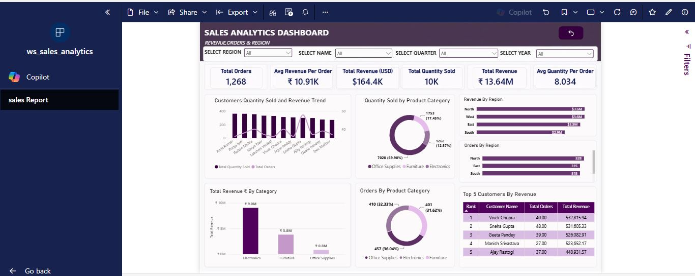
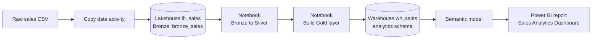

# Sales Analytics with Microsoft Fabric and Power BI

An end-to-end sales analytics project built in **Microsoft Fabric**. Raw sales data (CSV) moves through a **Bronze, Silver and Gold** lakehouse pipeline into a **warehouse**, and is shown in an interactive **Power BI dashboard**.

> **Why I built this:** Sales reports were built by hand and took a long time. I wanted one automatic flow from raw file to dashboard, so the team can see revenue, orders and regions in seconds.

---

## Dashboard preview



---

## Architecture



| Layer | What it holds | Where |
|---|---|---|
| **Bronze** | Raw data exactly as it arrived (`bronze_sales`) | Lakehouse `lh_sales` |
| **Silver** | Cleaned data with correct types | Lakehouse `lh_sales` |
| **Gold** | Summary tables ready for reporting | Lakehouse, then loaded to Warehouse |
| **Warehouse** | Star schema used by Power BI | Warehouse `wh_sales`, schema `analytics` |

---

## Tech stack

- Microsoft Fabric (Lakehouse, Warehouse, Data Pipeline, Notebooks)
- PySpark / Spark SQL (notebooks) and T-SQL (warehouse)
- Delta tables
- Power BI (semantic model, DAX measures, report)

---

## Data pipeline

The pipeline `Pl_ingest_sales` runs five steps in order:

| # | Activity | Type | What it does |
|---|---|---|---|
| 1 | `CopyRawSalesCSV` | Copy data | Copies the raw sales CSV file |
| 2 | `Copydatatodelta` | Notebook | Saves the data as a Delta table (Bronze) |
| 3 | `TransformBronzetoSilver` | Notebook | Cleans the data (Silver) |
| 4 | `BuildGoldLayer` | Notebook | Builds the summary tables (Gold) |
| 5 | `Transformsilvertowarehouse` | Copy data | Loads the data into the warehouse |


---

## Data model

The warehouse uses a **star schema** in the `analytics` schema:

- `fact_sales`: one row per order
- `dim_customer`
- `dim_date` (731 rows, two full years of dates)
- `dim_product`
- `dim_region`


### Raw data columns (Bronze)

`OrderID`, `OrderDate`, `CustomerName`, `Region`, `ProductCategory`, `Revenue`, `Quantity`, `Status`

The `Status` column includes values such as Active, Returned and Cancelled.


---

## Dashboard

The report has four filters (**Region, Name, Quarter, Year**) and these views:

- **Key numbers:** Total Orders, Total Revenue (₹ and USD), Total Quantity Sold, Avg Revenue Per Order, Avg Quantity Per Order
- **Customers:** quantity sold and revenue trend, top 5 customers by revenue
- **Products:** quantity sold, orders and revenue by product category
- **Regions:** revenue and orders by region

### Key numbers (all filters set to "All")

| Metric | Value |
|---|---|
| Total Orders | 1,268 |
| Total Revenue | ₹13.64M (about $164.4K) |
| Total Quantity Sold | about 10K |
| Avg Revenue Per Order | ₹10.91K |
| Avg Quantity Per Order | 8.03 |

### What the data shows

- **Electronics** earns about two-thirds of revenue (₹9.0M) from only about 13% of units sold.
- **Office Supplies** is about 70% of units sold but the lowest in revenue (₹0.8M).
- **Regions** are close. North and West lead (3.6M each) and South is lowest (2.9M).
- The **top 5 customers** bring in about 19% of total revenue.

---

## How to run this project

1. Create a Fabric workspace (a trial works) and add a **Lakehouse** (`lh_sales`) and a **Warehouse** (`wh_sales`).
2. Upload your sales CSV to the lakehouse **Files** area.
3. Create the notebooks for Bronze to Silver and Gold. [Add your notebook names or links here.]
4. Create the pipeline `Pl_ingest_sales` with the five activities above and run it.
5. Create a **semantic model** on the warehouse tables and set the relationships.
6. Build the Power BI report and add your measures.

---

## Project structure

```
fabric-sales-analytics/
├── README.md
├── images/
│   ├── warehouse.jpg
│   ├── lakehouse.jpg
│   ├── pL_ingest.jpg
│   └── fabric powerbi project.jpg
├── Sales Report.pbit   
```


## Author

**LENA SHAJAHAN**
